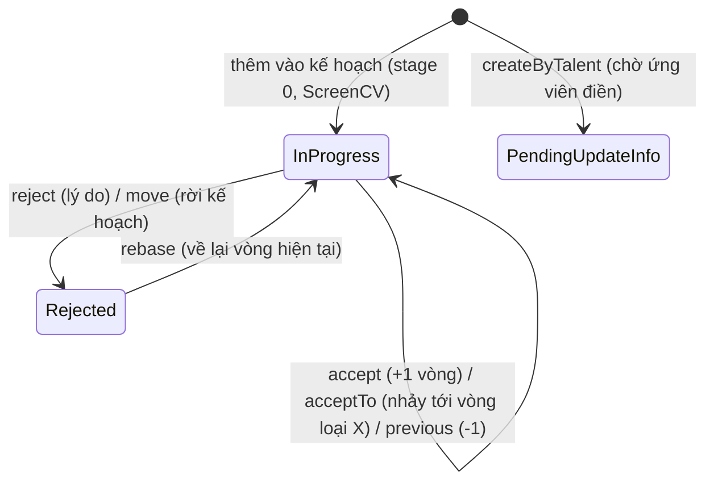

# Hồ sơ ứng viên trong kế hoạch (Application) và pipeline các vòng

Một **application** = một ứng viên (talent) đang đi qua các vòng của một kế hoạch tuyển dụng. Vòng của kế hoạch = `beginningStages + stages + endingStages` nối thành một dãy; application giữ chỉ số `currentStage` trong dãy đó.

## Mô hình & trạng thái

- `status` (`ApplicationStatusEnum`): `in-progress` · `accepted` · `rejected` · `pending-update-info` (chờ ứng viên bổ sung thông tin).
- `currentStage` (số), `currentCode` = `<type>-<chỉ số>`, `currentReason` (`ApplicationReasonEnum`), `histories[]` (mỗi dòng: fromStage, toStage, action, reason, actor, updatedAt), `tags` (có thể chứa `BREAK-RULE`), `isMarked`, `requireUpdateInfo`, `recruitmentPlan`, `recruitmentReq`, `talent`.
- Action trong lịch sử: `ACCEPT` · `REJECT` · `PREVIOUS` · `CHANGE` · `REBASE`. Lý do: `QUALIFIED`, `DISQUALIFIED`, `KEEP_IN_VIEW`, `BLACKLIST`, `MOVED`, `SKIP`, `SKIP_TO_OFFER`, `ABSENCE`, `PLAN_EDIT`, `REBASE`, `PREVIOUS`, `DECLINE_JOB`, `OTHER`.
- Loại vòng (`StageType`): `ScreenCV` · `ApproveInterview` · `Examination` · `Interview` · `TalentUpdating` · `TalentConfirmation` · `Offer` · `Other` · `ContractSigning` · `CheckList` · `Final`.
- **Vòng mặc định shinhanbank** (`DEFAULT_PLAN_STAGES`): beginning = ScreenCV "Lọc CV" (3 checklist) → stages = Interview "Phỏng vấn 1" → TalentUpdating "Bổ sung thông tin" (form `portal-talent-extra-info`) → Other "Offer" → ending = Final "Vòng cuối cùng". Wizard tạo kế hoạch trên staging có thêm vòng Shortlist/Interview×2/Offer/Add & Review Candidate Information (xem `recruitment-plans.md`) — **dãy vòng thật của kế hoạch QA khác danh sách này**, phải đọc từ kế hoạch.

## Thao tác (API) & điều kiện

| Thao tác | API (`/api/recruitment-plans/:planId/applications/...`) | Điều kiện | Kết quả / tác dụng phụ |
| --- | --- | --- | --- |
| Thêm vào kế hoạch | `POST /multiple-applications` (UI "Add talent"), `POST /by-talent` (tạo talent + hồ sơ) | Talent chưa có hồ sơ ở kế hoạch đó, nếu không → `400 application already exist` | `currentCode=<vòng đầu>-0`, `requireUpdateInfo=true`, mã hồ sơ ngẫu nhiên 8 ký tự; gắn checklist & mission checklist; talent được thêm `plan.talentPoolRef` vào `pools`; **gửi mail** (xem dưới) |
| Chuyển vòng kế | `PATCH /:id/accept` | Qua luật vòng (`strict` + `rules`; hiện `checklist`/`extra-info` luôn pass); **người làm có quyền với vòng** (xem Quyền); nếu tenant bật `STRICT_CHECK_LIST` thì mọi checklist của vòng phải `PASSED` | `currentStage+1`, ghi lịch sử `ACCEPT`; vòng kế là `ApproveInterview` → tạo phiếu đánh giá cho từng người duyệt vòng đó; vòng kế là `TalentUpdating` → `requireUpdateInfo=true` + **mail `TALENT_ADVANCED_INFO` cho ứng viên**; rời vòng `Final` → tạo checklist AMS |
| Nhảy tới vòng loại X | `PATCH /:id/accept-to/:type` `{reason}` | **Bắt buộc `reason`**; có quyền vòng; kế hoạch có vòng loại đó, nếu không → `offer stage not found` | `currentStage += (chỉ số vòng X − hiện tại)`; ghi `ACCEPT`. Không kiểm luật vòng, không gửi mail |
| Quay lại vòng trước | `PATCH /:id/previous` `{reason, interviewStgIdx?}` | Có quyền vòng | `currentStage−1`, `ACCEPT→PREVIOUS`; **thêm tag `BREAK-RULE`**; nếu có `interviewStgIdx` → mở lại lịch phỏng vấn & phiếu đánh giá của vòng đó (`HAPPENING` / `IN_PROGRESS`) |
| Từ chối | `PATCH /:id/reject` `{reason}` | Có quyền vòng (trừ khi là bước của `move`) | `status=rejected`, `currentReason=reason`, `isMarked=false`, ghi `REJECT`. Lý do `KEEP_IN_VIEW` / `BLACKLIST` / `DISQUALIFIED` → **đưa talent vào pool mặc định của tenant** (Keep in view / Blacklist / Reject) và rút khỏi pool của kế hoạch; tenant chưa có pool mặc định → `400 Tenant default pool not found`. Không thấy gửi mail trong hàm này |
| Mở lại (rebase) | `PATCH /:id/rebase` | — (không kiểm quyền) | `status=in-progress`, ghi `REBASE`; **giữ nguyên vòng hiện tại** (step 0) |
| Chuyển sang kế hoạch khác | `PATCH /:id/move` `{planId, isKeep, sectionCodes?}` | Talent chưa có hồ sơ ở kế hoạch đích | Nếu `!isKeep` → reject hồ sơ cũ (lý do `MOVED`); tạo hồ sơ mới ở vòng 0, copy extra-info theo `sectionCodes` |

- Mọi thay đổi vòng ghi lịch sử bằng `$addToSet` nguyên tử (không ghi đè mảng).
- **Backend không kiểm trạng thái nguồn**: `accept`/`previous`/`acceptTo` không kiểm `status`, nên hồ sơ **đã `rejected` vẫn đổi được vòng** qua API; `accept` ở vòng cuối (`currentStage = tổng−1`) không chặn (nhưng `checkRoleUserStage` trả `false` ở vòng cuối trừ khi là người phụ trách kế hoạch/`allowAll`). → xem Nghi bug.

## Màn hình & thao tác (UI staging, xem chỉ-đọc 2026-10-11 trên kế hoạch có sẵn của người khác)

- **Màn kế hoạch** `/recruitment-plans/:planId/applications`: **bảng kanban theo vòng** (mỗi cột = một vòng, ví dụ "Application", "2 - CV tiềm năng", "3 - Phỏng vấn 1", "4 - Phỏng vấn 2", "5 - BSTT UV 1", "6 - Offer", "7 - BSTT UV 2", "8 - Kiểm tra thông tin ứng viên", "HRIS"), mỗi cột 2 tab `Ongoing (n)` / `Rejected (n)`; mỗi ứng viên là một thẻ (tên, giờ thêm, "2 days ago"). Thanh nút trên: Tools · nút trạng thái kế hoạch · chuyển kanban/bảng (icon `kanban`, `table-view`) · **nút thêm ứng viên (icon `user-add`)**. Menu bên trái có các trang theo loại vòng (Application, Interview, …, Details & Editing, Job posting).
- **Modal "Add talent"**: "List of Talent Pools" (chọn pool, mặc định "All Talent Pools") + "Talent Name" (tìm và chọn **talent có sẵn**) + nút `Add`. **Không tạo talent mới ở đây** → ứng viên QA phải được tạo trước ở trang Talents và thuộc một pool.
- **Thẻ ứng viên** `/recruitment-plans/:planId/applications/:applicationId`: thanh vòng ở trên ("Recruitment process"); nút `Request for Additional Information` · `Print interview result` · `Create Interview` (vòng Phỏng vấn) · **`Reject`** · **`Pass`** (= chuyển vòng kế) · `Add` · `View attached file`; các khối "Recruitment Information", "Additional Information Request History", "Screen CV", "Shortlist", "Interview Mission", "Interview Stages". Nút thay đổi theo loại vòng.
- ⚠️ **Chỉ mở thẻ ứng viên cũng ghi `POST /api/interactions`** (nhật ký xem hồ sơ). Cũng có loại mail `APPLICATION_CV_VIEWED` — chưa rõ có gửi khi xem không. Khi khám phá bằng người thật/hồ sơ người khác thì tránh mở thẻ không cần thiết.
- Trong kế hoạch có sẵn trên staging có cột vòng thật của tenant (khác `DEFAULT_PLAN_STAGES`): số vòng và tên do từng kế hoạch cấu hình.

## Quyền (`checkRoleUserStage`)

Cho phép khi: user `allowAll` (admin hệ thống), **hoặc** user nằm trong `plan.assignTo` (người phụ trách kế hoạch), **hoặc** vòng hiện tại không giới hạn ai (`assignTo`, `assignToGroups`, `approvers` đều rỗng), **hoặc** user thuộc `assignTo` / `approvers` / nhóm `assignToGroups` của vòng đó. Đang ở **vòng cuối** → từ chối (trừ người phụ trách/`allowAll`). Tài khoản QA là người phụ trách kế hoạch QA tạo ⇒ luôn có quyền.

## Quy tắc dữ liệu về ứng viên (talent)

- Tìm talent **theo `basics.email`**. Một talent chỉ được có **một hồ sơ `in-progress` tại một thời điểm** trên toàn hệ thống (`createByTalent` → `400 TALENT_PROCESS_OTHER_PLAN`; `/by-talent` đi qua luật này, `/multiple-applications` thì chỉ chặn trùng cùng kế hoạch).
- Talent bắt buộc thuộc ≥1 pool (`pools` required). Có endpoint kiểm trùng `POST /talents/validate` `{email, phone, ids}`. Tạo talent **không gửi mail**. Tên được chuẩn hoá (`formatName`), tách `firstName/lastName`.
- Mã ứng viên (`ids` loại `code`) sinh từ id talent.

## Tác dụng phụ — mail & thông báo (RỦI RO CAO)

| Khi | Gửi tới | Ghi chú |
| --- | --- | --- |
| Thêm hồ sơ vào kế hoạch (`create`) | **Ứng viên** (`APPLICATION_ADDED_NOTIFY_TALENT`) và **người phụ trách kế hoạch**, cc `campaign.assignTo` (`..._NOTIFY_ASSIGN_TO`) | Gửi khi kế hoạch có cấu hình mail loại đó (autoSend); lỗi gửi bị nuốt |
| `createByTalent` | Ứng viên (`TALENT_ADVANCED_INFO`, link bổ sung thông tin) | Gửi luôn, không kiểm autoSend |
| `accept` tới vòng `TalentUpdating` | Ứng viên (`TALENT_ADVANCED_INFO`) | |
| `accept` tới vòng `ApproveInterview` | Người duyệt vòng (phiếu đánh giá + thông báo/mail đánh giá) | |
| Đặt lịch phỏng vấn, offer, ký hợp đồng… | Ứng viên + người phỏng vấn | Chưa học (luồng sau) |

→ **Ứng viên giả của bộ test phải có email = hộp thư QA** (`dev_shinhanbank@shinhanbank.com`) — nếu không, mail "đã thêm vào kế hoạch" sẽ gửi ra ngoài thật. Vì talent tìm theo email và chỉ một hồ sơ `in-progress`/lần, mỗi lần chỉ giữ được **một** ứng viên QA đang xử lý (hoặc phải dùng email dạng `dev_shinhanbank+<n>@shinhanbank.com` — chưa biết SMTP có chuyển về cùng hộp thư không).

## Điểm chưa chắc

- [x] UI cơ bản đã xem (kanban, modal Add talent, thẻ ứng viên: `Pass` / `Reject`). **Chưa xem**: modal khi bấm `Pass`/`Reject` (có bắt buộc lý do không, có chọn lý do KEEP_IN_VIEW/BLACKLIST/DISQUALIFIED không), nút "Quay lại vòng trước" và "Mở lại (rebase)" nằm ở đâu, tab `Rejected`. Cần một hồ sơ QA thật để xem (không bấm vào hồ sơ người khác).
- [ ] Tạo talent ở đâu/thế nào (trang Talents): trường bắt buộc, chọn pool, có kiểm trùng email/số điện thoại (`/talents/validate`) và có mail khi tạo không (backend không gửi).
- [ ] Mail "đã thêm vào kế hoạch" có thật sự gửi trên shinhanbank không (seed `mail-templates.yaml` shinhanbank **không có** template `ApplicationAddedNotifyTalent` / `ApplicationAddedNotifyAssignTo`; handler cần template `private: true` của tenant, thiếu thì ném `Mail template not found` và bị nuốt)? Quyết định có cần ứng viên giả dùng email QA hay không.
- [ ] Email dạng `dev_shinhanbank+tag@…` có về cùng hộp thư không (cần user/vận hành xác nhận) — để tạo nhiều ứng viên song song.
- [ ] `reject` có gửi mail/thông báo cho ứng viên không (hàm không gọi mail; có thể do event/handler khác).
- [ ] Vòng `Interview`, `Examination`, `Offer`, `ContractSigning`, `CheckList`, `Final`: mỗi loại có màn riêng (`/interviews`, `/examination`, `/offers`, `/contract-signing`, `/checklist`, `/final`…) — chưa học luật riêng, lịch hẹn, phiếu đánh giá, mail kèm theo.
- [ ] Luật vòng `strict`+`rules` hiện luôn pass (hàm kiểm `checklist`/`extra-info` luôn trả `true`) — cố ý hay chưa làm xong?
- [ ] Ứng viên bị `rejected` rồi `accept`/`previous` được qua API — quy tắc nghiệp vụ mong muốn là gì?
- [ ] `rebase` không kiểm quyền và không kiểm lý do — cố ý?

## Nghi bug

- 2026-10-11 · (API, chưa có spec) · `accept` / `previous` / `accept-to` không kiểm `status` hồ sơ: hồ sơ `rejected` vẫn chuyển vòng được qua API (cùng họ với "YCTD đã huỷ vẫn duyệt được qua API"). UI có thể đã ẩn nút — chưa kiểm.
- 2026-10-11 · (API, chưa có spec) · `rebase` không kiểm quyền (`checkRoleUserStage`) và không kiểm hồ sơ đang `rejected`: gọi cho hồ sơ `in-progress` vẫn ghi lịch sử `REBASE` vô nghĩa.
