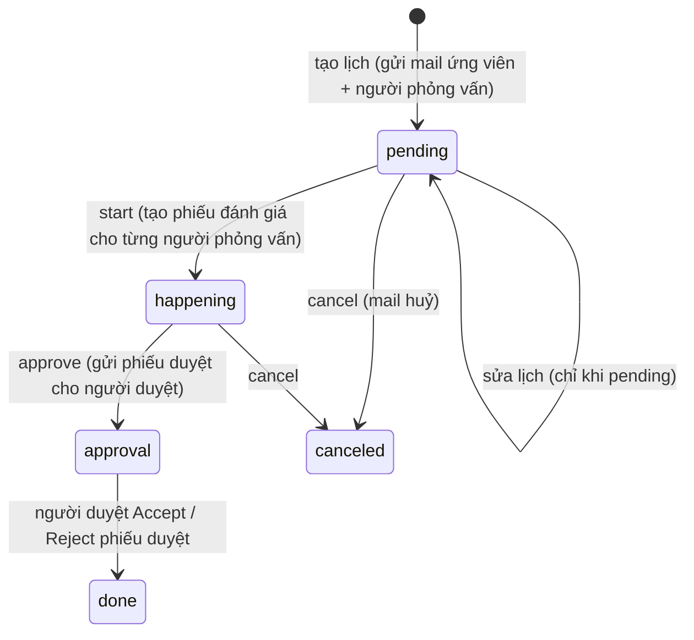

# Phỏng vấn, lịch hẹn và phiếu đánh giá

Ba tầng: **lịch hẹn (schedule)** → **nhóm lịch (schedule-group, phỏng vấn tập thể / nhiều ứng viên)** → **phiếu đánh giá (evaluation-form)** gom thành **nhóm phiếu (evaluation-form-group)**. Chúng gắn với một application đang ở vòng `Interview` hoặc `Examination` (vòng `ApproveInterview` dùng phiếu duyệt).

## Trạng thái

- `Schedule.status`: `pending` → `happening` → `approval` → `done` (hoặc `canceled`). `scheduleResult` (khi `done`): `accepted` · `rejected` · `talent-rejected` · `talent-accepted`. Loại: `Examination` · `Interview`. Ứng viên phản hồi: `InterviewTalentStatus` `accepted`/`rejected`.
- `EvaluationForm.status`: `open` → `in-progress` → `closed`; `type`: `Interview` · `Approve-Interview` · `Approve-CV`; kết quả duyệt (`evaluationFormResult`): `consider` · `rejected` · `accepted` · `cancelled` · `none`.

## Thao tác & luật (API)

| Thao tác | API | Luật | Tác dụng phụ |
| --- | --- | --- | --- |
| Tạo lịch | `POST /schedules` | Không trùng **phòng** hoặc **người phỏng vấn** với lịch khác (xem dưới); buổi `online` không chiếm phòng | Mail `SCHEDULE_TALENT` cho **ứng viên**, `SCHEDULE_USER` cho người phỏng vấn |
| Sửa lịch | `PATCH /schedules/:id` | **Chỉ sửa được khi `pending`** (`schedule-not-editable`); ứng viên/application bị khoá, chỉ đổi hội đồng/giờ/phòng | Mail `SCHEDULE_CHANGE_TALENT` / `..._USER` tuỳ cờ `isSendMailTalent`, `isSendMailInterviewer` (mặc định **true**) |
| Bắt đầu | `PATCH /schedules/:id/start` | Trạng thái mới phải khác trạng thái cũ (`Status is same`) | **Tạo 1 phiếu `Interview` cho mỗi người phỏng vấn** + thông báo/mail `EVALUATION_FORM`; tạo phiếu `Approve-Interview` cho mỗi người trong `approveBy` |
| Gửi duyệt | `PATCH /schedules/:id/approve` | Phải có phiếu `Approve-Interview` | Thông báo `EVALUATION_FORM` cho người duyệt |
| Huỷ | `PATCH /schedules/:id/cancel` | — | Mail `SCHEDULE_CANCEL_TALENT` / `..._USER` (cờ `isSendMailTalent`/`isSendMailInterviewer`, mặc định true) |
| Nhập kết quả | `PATCH /schedules/:id/accept|reject` | — | `status=done`, `scheduleResult` |
| Nộp phiếu | `PATCH /evaluation-forms/:id/end` `{status,…}` | **Bắt buộc `status`** (`Status is required`) | Khi **mọi phiếu `Interview` của vòng đã nộp** (không còn `open`/`in-progress`) → thông báo `EVALUATION_FORM_INTERVIEW` cho **người phụ trách kế hoạch** để họ duyệt kết quả |
| Duyệt phiếu | `PATCH /evaluation-forms/:id/approve-form/accept|reject` | Phiếu phải là `Approve-Interview`; đã `accepted`/`rejected` thì `Cannot change status` | Lịch → `done` + `scheduleResult accepted|rejected`; mail `EVALUATION_FORM_APPROVE_INTERVIEW` |
| Duyệt CV | `PATCH /evaluation-forms/:id/accept|reject` | Đã accepted/rejected thì `Cannot change status` | Mail `EVALUATION_FORM_APPROVE_CV` |
| Gửi lại phiếu | `PATCH /evaluation-forms/:id/resend` | — | Gửi lại thông báo |
| Phiếu nhóm | `PATCH /evaluation-form-groups/:id/start|end|approve-cv`, `approve-form/update-result` | — | Khi duyệt nhóm **đạt**: mỗi ứng viên trong nhóm **tự +1 vòng** (`ACCEPT`/`QUALIFIED`, `typeUpdate USER`); nếu tenant bật cờ `SEND_EMAIL_APPLICATION_EVALUATION_FORM_ACCEPTED=true` và vòng kế **không phải** Interview → mail `GLOBAL_PASS_TALENT` cho **ứng viên** |

### Luật trùng lịch (`schedule-conflict.util.ts`)

- Hai lịch **giao nhau theo khoảng nửa mở**: 9:00–10:00 và 10:00–11:00 **không** trùng.
- Trùng nếu cùng **phòng họp** (`meetingRoom`) hoặc có **cùng người phỏng vấn** trong khoảng giao nhau → báo lỗi, không tạo/sửa được.
- **Phỏng vấn online (`scheduleMethod = 'online'`) không chiếm phòng**, dù payload có mã phòng. Lịch cũ không có `scheduleMethod` vẫn coi là chiếm phòng.
- Khi sửa, lịch đang sửa không tính trùng với chính nó. Có API `schedules/busy` để xem ai/phòng nào bận.

## Nhóm lịch (`schedule-groups`) — phỏng vấn nhiều ứng viên

`POST /schedule-groups` (`createMultiple`), `PATCH /:id/add-application`, `start|approve|cancel`, `approve-form`, `email-preview`. Mỗi ứng viên/người phỏng vấn nhận mail dạng `*_GROUP` (`SCHEDULE_TALENT_GROUP`, `SCHEDULE_USER_GROUP`, và `CHANGE`/`CANCEL`). Cho phép **mẫu mail tuỳ biến theo kế hoạch** (xem trước bằng `email-preview`).

- Preview chỉ thay **subject/body/cc**; `tenant`, `wiseu` và `content.metadata` lấy từ mẫu gốc (nguồn: `schedule-groups.service.ts`, hàm build preview).
- `To` và `mergeRecipients` chỉ gắn vào preview của **người phỏng vấn đầu tiên** (`index === 0`), để `To` không bị gửi lặp cho mỗi người phỏng vấn; preview của những người còn lại không có `To` (nguồn: `schedule-groups.service.ts`, comment trong code).

## Mail / thông báo (RỦI RO CAO)

Gửi tới **ứng viên**: `SCHEDULE_TALENT`, `SCHEDULE_CHANGE_TALENT`, `SCHEDULE_CANCEL_TALENT`, các bản `_GROUP`, `GLOBAL_PASS_TALENT`. Gửi tới **người phỏng vấn/người duyệt/người phụ trách**: `SCHEDULE_USER*`, `EVALUATION_FORM*`. Qua `SchedulesNotificationPublisher` (sự kiện thông báo) nên có thể là mail + thông báo trong app. Để an toàn: ứng viên QA có email hộp thư QA; **người phỏng vấn, người duyệt, người phụ trách kế hoạch = tài khoản QA**.

## Điểm chưa chắc

- [ ] UI: màn tạo lịch (route `/interviews`, `/examination`), nút "Create Interview" trên thẻ ứng viên, nhãn tiếng Anh, trường bắt buộc, chọn phòng/giờ — **chưa xem**.
- [ ] Danh sách phòng họp (`masterdata.meeting-room`), cách đặt phòng/online link (`getOnlineLink`) trên staging.
- [~] Mẫu mail lịch/phiếu: `NOTIFICATION_POLICY` shinhanbank **có** sự kiện `schedule.*`, `schedule-group.*`, `evaluation-form*` (inApp + email, mẫu `ScheduleTalent`, `ScheduleUser`, `EvaluationForm`…) nên **sẽ gửi** — mẫu nằm ở kho thông báo (`NOTIFICATION_TEXT`), không phải `mail-templates.yaml` (xem `tenant-config-and-notifications.md`). Vẫn cần kiểm bằng `emails/v2` sau lần tạo lịch đầu.
- [ ] `updateStatus` không kiểm chuỗi trạng thái hợp lệ (vd `pending → done` trực tiếp, `done → happening`) — chỉ cấm đặt trùng trạng thái. Cố ý?
- [ ] `PATCH /schedules/:id/accept|reject` dùng `updateResult`: đặt `done` mà không kiểm trạng thái nguồn, không tạo phiếu.
- [ ] Nhóm phiếu "đạt" tự +1 vòng không kiểm `status` hồ sơ (hồ sơ đã `rejected` vẫn +1?) và không kiểm vòng cuối (`stages[toStage]` có thể `undefined` → lỗi).
- [ ] Khi nào ứng viên `talent-accepted`/`talent-rejected` (phản hồi lịch từ portal)?

## Nghi bug

- 2026-10-11 · (code, chưa có spec) · `nextStepApplication` (nhóm phiếu đạt) dùng `stages[toStage].type` không kiểm `toStage < stages.length`: ứng viên ở vòng Interview **cuối cùng** của dãy (vòng sau không tồn tại) sẽ ném lỗi `Cannot read properties of undefined (reading 'type')` sau khi đã `findByIdAndUpdate` +1 vòng → trạng thái lưu nhưng request lỗi. Trường hợp thực tế hiếm (sau Interview thường còn Offer/Final).

## Đã đổi theo commit mới

- 2026-10-22 · aa1fe551a → 3ebed5507 · `schedule-groups.service.ts` — email-preview: preview giờ giữ `tenant`, `wiseu`, `metadata` của mẫu gốc cho mọi người phỏng vấn (trước chỉ người đầu có `original`); `To`/`mergeRecipients` chỉ gắn vào preview đầu tiên (đã ghi ở mục Nhóm lịch).
- 2026-10-22 · aa1fe551a → 3ebed5507 · `evaluation-form-groups.service.ts` — populate `scheduleGroup` thêm `startTime endTime`; không đổi luật nghiệp vụ.