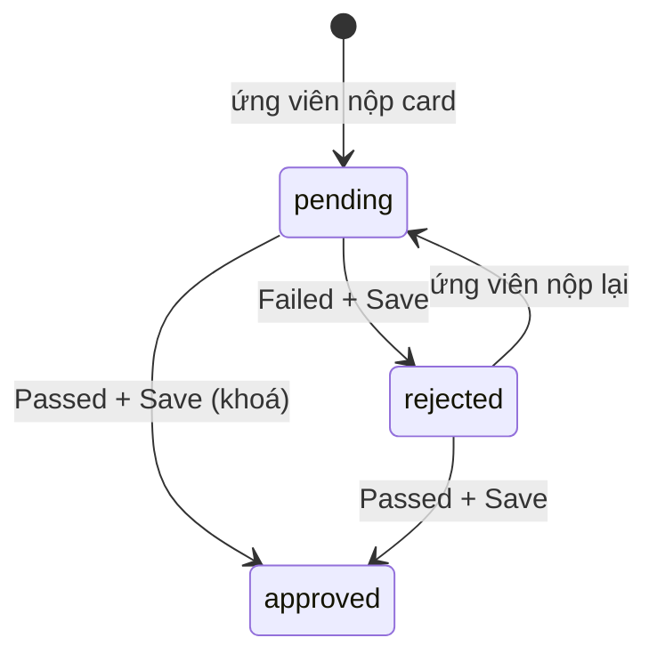

# Kiểm tra thông tin ứng viên (Review Candidate Information, StageType `TalentConfirmation`)

Chỉ ghi phần mới; bối cảnh vòng BSTT/Offer/HRIS xem `ui-walkthrough-applications.md` mục 10 và `offers-and-onboarding.md`.
Phiên này **không mở UI staging** (chỉ đọc code); phần "UI staging" bên dưới trích từ walkthrough 2026-10-11.

## Trạng thái & chuyển trạng thái

Vòng nằm trong dãy vòng của kế hoạch (kế hoạch mẫu: "8 - Kiểm tra thông tin ứng viên", sau "7 - BSTT UV 2", trước "HRIS" = vòng Final). Mỗi **card** của form portal có `TalentExtraInfoStatus`: `pending` → `approved` | `rejected`.

| Hành động | API | Điều kiện | Kết quả |
| --- | --- | --- | --- |
| Xem card | `GET /applications/:id/talent-extra-info/review` | đăng nhập | chỉ trả card **đã được ứng viên nộp** |
| Pass all items | **chỉ UI**, không gọi API | nút ẩn nếu `onlyView` hoặc không còn card active ở `pending` | đặt mọi card active = Passed trên màn hình; **chưa lưu** |
| Save changes | `POST /applications/:id/talent-extra-info/review` `{cards:[{card,status,note}]}` | `checkRoleUserStage`; ≥1 card; card tồn tại; card đã nộp; card chưa `approved` | ghi `cardReviews`, status section suy ra từ các card (`deriveSectionStatus`), `reviewedBy/At`; trả view mới |
| Gửi onboarding email | `POST …/talent-extra-info/onboarding-email` | xem Tác dụng phụ | mỗi lần bấm gửi lại (không còn giới hạn 1 lần); bị chặn khi application `rejected` |
| Pass sang vòng kế | `PATCH …/accept` (UI "Meet expectation") | UI staging: sau khi Save thì có lại Meet expectation | sang HRIS |

Quy tắc (service `saveCardReview`):
- Card `approved` là **cuối cùng**: đổi sang trạng thái/ghi chú khác → 400 `TALENT_EXTRA_INFO_APPROVED_LOCKED`. Chỉ ứng viên nộp lại mới mở lại card. Gửi đúng trạng thái+ghi chú cũ thì bỏ qua (không lỗi).
- Card chưa nộp → 400 `Card <id> has not been submitted`; card lạ hoặc status ngoài enum → 400 `Unknown card <id>`; body rỗng → 400 `At least one card is required`; stage không có form đã publish → 400 `This stage has no published form`; thiếu quyền → 400 `NOT_ALLOWED`.
- Nếu **bất kỳ** card đặt `rejected`: application `requireUpdateInfo=true` + gửi lại mail yêu cầu bổ sung cho ứng viên (`RESEND_TALENT_ADVANCED_INFO`).
- **Quay lại/sửa sau khi lưu**: card `rejected`/`pending` sửa lại được; card Passed thì khoá. Nút **Undo** chỉ hoàn tác thay đổi **chưa lưu** (về trạng thái lưu gần nhất).
- Form lấy từ vòng hiện tại, không có thì vòng gần nhất phía trước có form portal.

Điều kiện Pass sang HRIS: **backend `accept` chưa đọc** (xem Điểm chưa chắc). Code UI `application.service.ts` chỉ cho thấy vòng TalentConfirmation được **bỏ qua khi tính định biên Offer** (vòng kế là Confirmation thì xét vòng sau nó).

## Quyền / vai trò

`checkRoleUserStage` (dùng cho `status`, `review` POST, `onboarding-email`): được nếu `user.allowAll`, hoặc user thuộc `recruitmentPlan.assignTo` (người phụ trách PATD), hoặc vòng hiện tại **không khai** assignTo/assignToGroups/approvers, hoặc user thuộc assignTo/approvers của vòng hiện tại (phần group/customPermission chưa đọc hết). Hồ sơ đang ở **vòng cuối** → luôn `false`. Các `GET` không kiểm quyền vòng.

## Quy tắc dữ liệu

- Số mục "x/10" **không có hằng số trong code**: số card = số card của **form portal đã publish** của vòng, lọc card đã nộp. Con số 10 phải xác nhận trên UI (walkthrough ghi form BSTT có 15 mục tài liệu, chưa khớp).
- Mỗi card: Passed / Failed + ô **Note** ("Enter note..."); ghi chú section = gộp ghi chú các card.
- Cờ tenant `ACCEPT_INFO_OVERRIDE_BASICS`: nếu `=== 'true'` (so chuỗi) thì card thuộc section `basics` được lưu sẽ **ghi đè `talent.basics`**. Seed stg có `ACCEPT_INFO_OVERRIDE_BASICS: true` (boolean YAML) — xem Điểm chưa chắc.
- `component_config.talent_confirmation.send_approval_emails: true` (stg shinhanbank, `tenants.yaml`) bật nút gửi onboarding email.
- Gửi onboarding email không còn chống trùng bằng email id cố định: mỗi lần bấm dùng nonce `Date.now()` làm id mail (`talent-extra-info.service.ts`), nên bấm đồng thời cũng có thể gửi mail trùng.

## Màn hình & thao tác

- Thẻ ứng viên vòng 8 (`/recruitment-plans/<id>/applications/<appId>`) hiện khối **"Additional information"** → "Form for additional information" ("Please review and update the information. Items that do not meet requirements must be supplemented or revised."). Danh sách: `/recruitment-plans/<id>/talent-confirmation` ("Review Candidate Information").
- Nút (EN): `Undo` (chỉ khi có thay đổi chưa lưu), `Pass all items`, `Save changes`, `Send onboarding email` (hiện khi `canSend`, kể cả sau khi đã gửi, trừ application `rejected`); badge `Not submitted` cho card chưa nộp.
- Sau khi đã gửi: không còn nút disabled. Thay vào đó hiện text có icon check ở **hàng tiêu đề khối** (cạnh "Form for additional information"): `Onboarding email sent · dd/MM/yyyy`, ngày lấy từ `onboardingEmailSentAt` (ghi đè mỗi lần gửi).
- Modal Pass all: "Are you sure?" / "If you confirm, the candidate will pass all information sections." → `Confirm`/`Cancel`.
- Modal Save: "Confirm saving this review?" / "Once saved, the sections marked as Passed are final and can no longer be edited." → `Confirm`. Thành công: toast "Saved successfully"; lỗi: "Unable to save the status or send the email. Please try again."
- Modal onboarding: "Send the onboarding email?" — "A notification is sent to the hiring manager and onboarding instructions are sent to the candidate." (câu "The email can only be sent once." đã bỏ).
- Vòng HRIS (Final): nút **Convert candidates to employees** (modal Create employee) và **Re-in progress**. **Không bấm Create** (đẩy nhân viên sang HRIS thật).
- `flows/offer.ts › verifyInfoToHris` khớp code: Pass all → Confirm → Save changes → bắt `POST …/talent-extra-info/review` → Confirm → `Pass` "Meet expectation" → thấy "Convert candidates to employees". Hàm bỏ qua nếu đã thấy nút Convert.

## Tác dụng phụ

- **Save có card Failed**: mail `RESEND_TALENT_ADVANCED_INFO` cho **ứng viên**. Template lấy theo mapping `RESEND_TALENT_ADVANCED_INFO` của plan; plan không có mapping đó thì dùng mapping `TALENT_ADVANCED_INFO` (`email-talent-advanced-info.ts`).
- **Save toàn Passed**: không gửi mail (theo `saveCardReview`). (Mail `TALENT_INFO_UPDATED` là khác: khi ứng viên nộp xong, gửi người phụ trách vòng Confirmation/Updating, không có thì `plan.assignTo`.)
- **Send onboarding email** (mỗi lần bấm gửi lại 2 mail; mỗi lần ghi đè `onboardingEmailSentAt/By`): 2 mail — `TALENT_INFO_APPROVED_MANAGER` tới **requestedBy của YCTD**, `TALENT_INFO_APPROVED_ONBOARDING` tới **email talent**. Từ chối khi application `rejected` (`TALENT_ONBOARDING_EMAIL_REJECTED`) hoặc chưa tới vòng Confirmation (`..._STAGE_NOT_REACHED`).
- Rời vòng Final: checklist `ams` + `APPLICATION_TO_EMPLOYER` (xem `offers-and-onboarding.md`).
- Tránh làm phiền người thật: talent dùng email QA; YCTD (requestedBy) và người duyệt là QA; **không bấm Send onboarding email** trừ khi cả hai chắc chắn là QA, vì mỗi lần bấm là gửi thêm mail thật; không bấm Convert.

## Điểm chưa chắc

- [ ] "x/10 mục": số 10 từ đâu? Code không có hằng; cần xem thẻ vòng 8 trên UI — nguồn đã xem: code + walkthrough.
- [ ] Điều kiện Pass (`PATCH …/accept`) từ vòng Confirmation sang HRIS: backend có chặn khi còn card chưa Passed/chưa Save không? Walkthrough chỉ nói "sau khi Save thì có lại Meet expectation" (có thể chỉ là UI) — chưa đọc `accept` trong `applications.service.ts`.
- [ ] Có Pass được khi còn card Failed (rejected)? Chưa xem.
- [ ] Save khi chỉ một phần card đổi trạng thái: code cho phép; UI staging chưa thử.
- [ ] `ACCEPT_INFO_OVERRIDE_BASICS`: seed boolean `true`, code so với chuỗi `'true'` — kiểm DB staging thật xem Passed card `basics` có ghi đè talent không.
- [ ] `checkRoleUserStage` nhánh `assignToGroups`/`customPermission` chưa đọc hết → ai (nhóm) được thao tác ở stg.
- [ ] stg `tenants.yaml` đã comment `defaultIds` `user-group` (`default`): có ảnh hưởng tới nhóm được thao tác vòng này không? — nguồn đã xem: `tenants.yaml` (diff 3ebed5507).
- [ ] Plan stg shinhanbank có mapping mail `RESEND_TALENT_ADVANCED_INFO` không (nếu không thì dùng `TALENT_ADVANCED_INFO`)? Và 2 mail onboarding có trong `mail-templates.yaml` stg, người nhận thật là ai — chưa đối chiếu `mail-templates.yaml`; nguồn đã xem: `email-talent-advanced-info.ts`.
- [ ] Nút `Pass all items` hiện khi nào (code: khi còn card active ở pending) và sau khi Save toàn Passed có ẩn không — chưa kiểm UI.
- [ ] "Re-in progress" ở HRIS: đưa về vòng nào, có mở lại card Passed không?
- [ ] Staging có sandbox HRIS cho Convert không (không thử).

## Nghi bug

(chưa có — phiên này không chạy test)

## Đã đổi theo commit mới

- 3ebed5507: Send onboarding email không còn chỉ gửi 1 lần (bỏ chặn theo `sentAt`, mỗi lần gửi dùng nonce, `canSend` true trừ khi application `rejected`); badge "Onboarding email sent · ngày" chuyển sang hàng tiêu đề, không còn nút disabled; bỏ câu "can only be sent once" trong modal (en.json); mail RESEND ưu tiên mapping `RESEND_TALENT_ADVANCED_INFO`; stg `tenants.yaml`: hostName đổi sang `shinhanbank.stg.talentx.vn`, `defaultIds.user-group` bị comment.