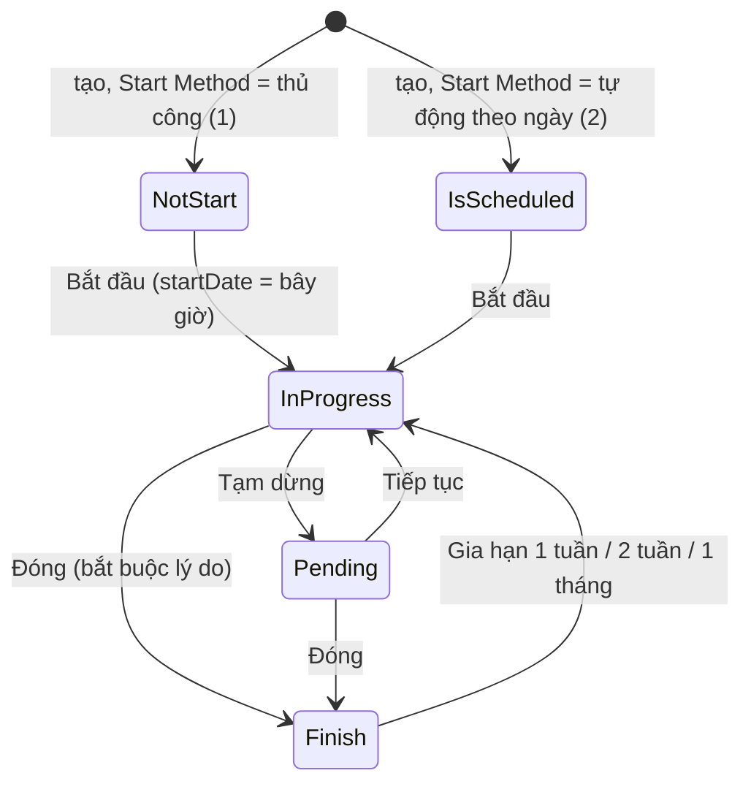

# Kế hoạch tuyển dụng (PATD / Recruitment Plan)

Kế hoạch gắn với **một YCTD đang Open**, chứa các vòng tuyển dụng (stages) mà ứng viên sẽ đi qua (pipeline — luồng M3).

## Trạng thái & chuyển trạng thái

`status` (`RecruitmentPlanStatus`): `is-scheduled` (Đã lập lịch) · `not-start` (Chưa bắt đầu) · `in-progress` (Đã bắt đầu) · `pending` (Đã tạm dừng) · `finish` (Đã kết thúc).

| Hành động (menu trạng thái) | Hiện khi | API | Kết quả |
| --- | --- | --- | --- |
| Bắt đầu (`start`) | `not-start`, `is-scheduled` | `PATCH /api/recruitment-plans/:id` `{status:'in-progress', startDate: now}` | `in-progress` |
| Tạm dừng (`pause`) | `in-progress` | `PATCH /:id/pause` | `pending` |
| Tiếp tục (`continue`) | `pending` | `PATCH /:id` `{status:'in-progress'}` | `in-progress` |
| Đóng (`end`) | `in-progress`, `pending` | `PATCH /:id/close` `{endDate: now, reason}` — UI **bắt buộc lý do** | `finish` + gỡ tin đăng ngoài (chờ kết quả từng site) |
| Gia hạn (`extend1w/2w/1m`) | `finish` | `PATCH /:id/extend` `{endDate: endDate cũ + 7/14/30 ngày}` | `in-progress`, endDate mới. Backend **400** nếu endDate mới không ở tương lai |

- Menu chỉ hiện các hành động trên theo trạng thái (UI chặn). **Backend không kiểm trạng thái nguồn** cho start/pause/continue (đổi thẳng `status`) → xem Điểm chưa chắc.
- Mọi đường lưu `status: finish` lên kế hoạch chưa kết thúc đều đi qua thao tác đóng chung (`RecruitmentPlanCloseService`), kể cả sửa kế hoạch.
- **Liên luồng YCTD**: đóng YCTD ⇒ đóng mọi kế hoạch chưa `finish` của nó (`source: 'request'`). Kế hoạch `finish` mà YCTD đã đóng (`statusCO='1'`) ⇒ nút trạng thái bị làm mờ (class `disable`) — không gia hạn được.

## Quyền / vai trò

- Thấy kế hoạch (`CheckPublicInterceptor`): `createdBy`, có trong `assignTo`, là `assignTo`/`approvers` của một vòng, khớp `tags`, hoặc là người tạo / requestedBy / assignTo / requestedForList / người duyệt của YCTD gốc.
- Không có kiểm tra quyền riêng cho start/pause/close/extend ngoài quyền action `Update-One`.

## Quy tắc dữ liệu

- **Mã kế hoạch** = mã YCTD + 3 chữ số tăng dần theo YCTD: `NI26075` → `NI26075001`, `NI26075002`… (lấy kế hoạch mới nhất có `code` chứa mã YCTD, +1). Không có YCTD → không có mã (trừ kế hoạch có `channel`+`agentType`).
- Tạo kế hoạch tự gắn các checklist template mặc định (tag DEFAULT) và, nếu có vòng `ApproveInterview`, tạo nhóm phiếu đánh giá cho từng người duyệt vòng đó.
- Mã vòng (`stage.code`) = `<type>-<chỉ số>` (vd `ScreenCV-0`).
- **Form tạo** — route `/recruitment-plans/create/initial` (vào bằng nút **Create recruitment plan** trên `/recruitment-plans`; mở thẳng `/recruitment-plans/create` sẽ khớp nhầm route `:planId` → trang rỗng). Nhiều phần: initial → setting → mission → valuation → contact.

  | Phần | Trường (`name`) — `*` bắt buộc |
  | --- | --- |
  | initial (`recruitment-plan-form-initial`) | `sample` (mẫu kế hoạch — tuỳ chọn) · `recruitmentReq` Recruitment Request Code (**chỉ YCTD `statusCO='0'`**, tìm theo text; mở từ YCTD có `?request=<code>` thì điền sẵn) · `plansList` (kế hoạch đã có của YCTD) · `jobTitle`, `quantity`, `reason`, `requestedDate` (lấy từ YCTD) · `name`* Recruitment Plan · `description` Notes · `assignTo`* Person in charge (**mặc định = người đăng nhập**) · `isScheduled`* Start Method (1 thủ công — mặc định / 2 tự động theo ngày) · `date_range`* (chỉ khi = 2) · `jobDescriptionRef`* · `talentPoolRef`* |
  | setting (`…-form-setting`) | vòng sàng lọc CV: `checkList`* Filter criteria · các vòng: `type`* Category, `name`* Round Name, `assignTo` Interviewers, `approvers` Final approver · vòng cuối Final, tên mặc định "HRIS" |
  | mission | `type`* Mission (lặp) |
  | valuation | `competencyGroupRef`* Interview Assessment sample (mặc định mẫu đầu tiên) |
  | contact | mail theo loại (`mails[]`: type, mail, autoSend) |

- Payload initial: `isScheduled` = (Start Method = 2); `status` = `is-scheduled` nếu 2, ngược lại `not-start`; `startDate` = ngày đầu khoảng (không có thì `yctd.requestedDate`); `endDate` = ngày cuối khoảng; `quantity` **luôn = 1**, số nhập nằm ở `quantity_`.

## Màn hình & thao tác (UI staging 2026-10-10)

- Danh sách `/recruitment-plans`: nút **Create recruitment plan**; cột: Recruitment plan name · Recruitment Plan Status (vd "Started") · Time · Person in charge · Expected Quantity · Number of available candidates · Đơn vị · Recruitment Request · Nguồn đăng tin.
- Trang tạo: nút `Cancel` / `Continue`; bên trái các bước "Recruitment information" → "Setup hiring stages" → "Background check" → "Competency Groups" → ….
- Ô **Recruitment Request Code**: danh sách mặc định = 30 YCTD Open mới nhất; **gõ mã YCTD (vd `NI26075`) không ra kết quả** (API `$text` trả 0 dòng), gõ theo tên thì ra — xem Nghi bug. Flow tìm bằng hậu tố thời gian trong tên YCTD rồi chọn dòng có mã.
- Chọn YCTD xong: tự điền Job title, Number of recruitment, Recruitment Method, Request date; Person in charge = "Thong Quản trị Hệ thống" (YCTD `[AUTOTEST]`); Start Method mặc định "Schedule manually" (khác: "Automatically schedule recruitment plan"); Job Description chọn từ 7 mẫu (Backend Developer, Tester…).
- Trang kế hoạch: nút trạng thái (hiển thị trạng thái hiện tại, bấm mở menu hành động ở bảng trên); modal xác nhận dùng nút "xác nhận"/"đóng" (nhãn tiếng Anh chưa kiểm).

## Wizard tạo kế hoạch (UI staging, kiểm chứng 2026-10-10 — tạo thật `NI26096001` v.v.)

Năm bước (nav bên trái): 1 Recruitment information → 2 Setup hiring stages → 3 Background check → 4 Competency Groups → 5 Setup communication. Nút chính `Continue` ở mọi bước, bấm tới khi app gửi `POST /api/recruitment-plans` (trả `_id`, `code`). Bước 3–5 **có sẵn mặc định**, không phải điền.

- **Form tải bất đồng bộ**: bấm `Continue` quá sớm → toast "Vui lòng chờ tải xong biểu mẫu" và không qua bước (cả bước 1→2 và 2→3). Phải bấm lặp.
- **Bước 1**: ô Recruitment Request Code chỉ tìm được theo **tên** (xem Nghi bug); chọn xong tự điền Job title / Method / Person in charge. Job Description chọn "Chuyên viên Kiểm thử phần mềm (Tester)" (có 7 mẫu). Talent Pool: danh sách dài, phải **gõ tìm** (vd "TA POOL"); tránh pool "Hạn chế tuyển dụng" / "Nga pool hạn chế tuyển dụng nè" (pool hạn chế).
- **Bước 2** — bảng "Recruitment process" có sẵn 8 vòng mặc định; mỗi loại dòng có ô khác nhau:

  | Dòng | Ô bắt buộc | Cách điền |
  | --- | --- | --- |
  | Shortlist | Interviewers | `nz-select` người (tìm phía server, **gõ từng ký tự**; `fill` không kích hoạt tìm) |
  | Interview (×2) | Interviewers **và Final approver** | 2 `nz-select` người (ô thứ 2 và thứ 3 của dòng) |
  | Offer | Interviewers | Ô **bấm được** (không phải `nz-select`) → mở khung "Set up a review process" (Approval Level 1: Approver → Save) |
  | Add Candidate Information (×2) | không | đã có loại tài liệu mặc định |
  | Review Candidate Information | 1 ô ghi "Chọn thành viên" nhưng **thực chất chọn loại tài liệu** (Talent Information / Additional Documents / Candidate Infomation & Documents) | chọn mục đầu |
  | Final Stage | không | tên mặc định "HRIS" |

  "Receive CVs › Filter criteria" để trống được. Nhãn lỗi "Required Field!" hiện ngay dưới ô còn thiếu.
- Sau khi tạo: `status = not-start`, `websites = []` (chưa publish → không lộ ra portal), `code = <mã YCTD>001`.

## Màn hình kế hoạch (menu trạng thái)

Trang `/recruitment-plans/:id`, nút `button.plan-status-button` mở menu — **nhãn menu tiếng Anh khác tên hành động**:

| Trạng thái | Mục menu | Gọi | Kết quả (đã kiểm chứng) |
| --- | --- | --- | --- |
| `not-start` | Start Recruitment Plan | `PATCH /api/recruitment-plans/:id` | `in-progress` |
| `in-progress` | On hold · Closed | `PATCH /:id/pause` · `PATCH /:id/close` | `pending` · `finish` |
| `pending` | Continue… · Closed | `PATCH /:id` · `PATCH /:id/close` | `in-progress` · `finish` |
| `finish` | Extend (1 tuần / 2 tuần / 1 tháng) | `PATCH /:id/extend` | `in-progress`; `endDate` = endDate cũ + 7 ngày (`2026-10-10T17:00Z` → `2026-10-17T17:00Z`) |

- Đóng ghi `endDate = bây giờ`; đóng xong gia hạn 1 tuần ⇒ endDate nằm ở tương lai ✔.
- **Xoá mềm kế hoạch**: `DELETE /api/recruitment-plans/:id` → 200 (UI không có nút xoá). `GET /api/recruitment-requests/:id` vẫn liệt kê kế hoạch đã xoá mềm trong `plan` → muốn biết kế hoạch còn sống phải GET riêng từng kế hoạch (200 = còn, 404 = đã xoá).

## Tác dụng phụ

| Khi | Ai / gì | Ghi chú |
| --- | --- | --- |
| Đóng kế hoạch | Gỡ tin đã đăng trên site ngoài (integration, `POST /integration-templates/:code`) | ⚠️ kế hoạch test **không được đăng tin ra ngoài** |
| Đóng kế hoạch | Email `RECRUITMENT_PLAN_FINISHED` cho **từng `assignTo`** (Person in charge) | Seed shinhanbank không có template này → có thể không gửi |
| Tạo kế hoạch | Nhóm phiếu đánh giá cho người duyệt vòng ApproveInterview | Người duyệt phải là QA |
| Tạo kế hoạch | Checklist mặc định gắn vào kế hoạch | — |

| Kế hoạch `in-progress` **và** có `websites` chứa website portal | Hiện công khai trên portal tuyển dụng (`apps/portal`), ứng viên ngoài nộp được | `websites` chỉ gắn khi publish/đăng tin; tạo + bắt đầu mà không publish thì **không** lộ ra portal |

- **Chọn YCTD tự điền Person in charge** = `assignTo` (TA Admin) của YCTD **+ người đăng nhập**, và JD từ `extra.jobDescriptionRef` của YCTD. YCTD thật ⇒ người thật thành người phụ trách kế hoạch (nhận email đóng kế hoạch). YCTD `[AUTOTEST]` có TA Admin = QA ⇒ chỉ QA.

→ Để không làm phiền người thật: chỉ tạo từ YCTD `[AUTOTEST]` đang Open; Person in charge, Interviewers, Final approver = tài khoản QA; không dùng mẫu kế hoạch (`sample`); **không publish/đăng tin** kế hoạch test.

## Tự động theo lịch (job scheduler)

`apps/services/job-scheduler/src/recruitment/recruitment.service.ts`, chạy theo cron `recruitmentPlanRunner.interval`
(env `APP_RECRUITMENTPLAN_RUNNER_INTERVAL`, bật bằng `APP_RECRUITMENTPLAN_RUNNER_ENABLED` — giá trị trên staging **không có trong repo**):

- **Tự bắt đầu**: kế hoạch `isScheduled = true`, `status = is-scheduled`, `startDate` nằm **trong ngày hôm nay tính theo UTC** → `in-progress`. Không quét bù: lỡ ngày (job tắt/lỗi đúng ngày đó) thì kế hoạch kẹt ở `is-scheduled`.
- **Tự kết thúc**: kế hoạch `in-progress` hoặc `pending` có `endDate ≤ cuối ngày hôm nay theo UTC` → đóng qua thao tác đóng chung (`source: 'cron'`, gỡ tin ngoài, giữ endDate đã hẹn).
- Ngày "hôm nay" tính theo **UTC**, còn người dùng chọn ngày theo giờ VN (+07). Nếu date picker gửi 00:00 giờ VN (= 17:00 UTC hôm trước) thì kế hoạch có thể **bắt đầu/kết thúc sớm một ngày** — chưa kiểm được payload thật (xem Điểm chưa chắc).
- Date picker "Start date - End date" không cho chọn ngày trước hôm nay.

## Điểm chưa chắc

- [x] Chỉ tạo kế hoạch từ YCTD Open → **đúng, nhưng chỉ UI chặn** (ô chọn YCTD lọc `statusCO='0'`); backend `create` không kiểm, không có chỗ nào khác kiểm (đã grep backend plan + share-function). → _Nghi bug (API)_.
- [x] Start/pause/continue → quy tắc theo menu UI; backend **không kiểm trạng thái nguồn**: "Bắt đầu"/"Tiếp tục" là `PATCH /:id` sửa thẳng `status`, nên gọi API có thể đưa kế hoạch `finish` về `in-progress` mà **bỏ qua kiểm endDate của Gia hạn**. → _Nghi bug (API)_.
- [x] Tự bắt đầu/kết thúc → có, job scheduler (mục trên).
- [x] `quantity` → mọi tenant đều cố định `quantity: 1` cho kế hoạch (dev/bvb, hsc, demo…); shinhanbank thêm ô "Number of recruitment" ghi vào `quantity_` nhưng **không code nào đọc** `quantity_` (grep toàn repo) → cột "Expected Quantity" luôn 1. → _Nghi bug (cấu hình)_.
- [x] Mã kế hoạch tìm bằng regex không lọc tenant → **không phải bug với shinhanbank**: mã YCTD `[NS][IR]YYNNN` chỉ có chữ ở đầu nên "chứa" ≡ "bắt đầu bằng"; tenant khác dùng định dạng khác (`YCTD-xxxxxxxx`…). Rủi ro còn lại: không có unique index trên `code` → hai người tạo kế hoạch cho cùng YCTD cùng lúc có thể trùng mã (không kiểm thử E2E được).
- [ ] Gia hạn khi YCTD đã đóng: UI chỉ thêm class `disable` cho nút trạng thái — khám phá khi viết flow.
- [ ] Setting / mission / valuation / contact: lựa chọn trên staging, phần nào bắt buộc — khám phá khi viết flow.
- [ ] Talent Pool / Job Description dùng cho kế hoạch test — khám phá khi viết flow (JD có thể tự điền từ `extra.jobDescriptionRef` của YCTD).
- [ ] Date picker gửi `startDate`/`endDate` dạng gì (00:00 +07 hay giờ hiện tại)? Quyết định có lệch một ngày không — xem payload khi flow tạo kế hoạch "tự động theo ngày".
- [ ] Cron `APP_RECRUITMENTPLAN_RUNNER_INTERVAL` trên staging là bao lâu? (cần để kiểm thử tự bắt đầu với startDate = hôm nay) — hỏi người vận hành.

## Nghi bug

- 2026-10-10 · (UI, chưa có spec) · Ô "Recruitment Request Code" trên form tạo kế hoạch không tìm được theo mã: gõ `NI26075` (YCTD đang Open) → `GET /api/recruitment-requests?s={"statusCO":{"$eq":"0"},"$text":"NI26075"}` trả 0 dòng; gõ `QA-AUTO` (một phần tên) thì ra. Nhãn ô là "Code" nên người dùng sẽ gõ mã.
- 2026-10-10 · (API, chưa có spec) · Tạo kế hoạch: backend không kiểm YCTD đang Open — chỉ UI lọc. Gọi thẳng `POST /api/recruitment-plans` được với YCTD đã đóng/huỷ/bị từ chối. Cùng loại với YCTD "đã huỷ vẫn duyệt được qua API".
- 2026-10-10 · (API, chưa có spec) · Bắt đầu/tiếp tục là `PATCH /api/recruitment-plans/:id {status}` không kiểm trạng thái nguồn → API đưa được kế hoạch `finish` về `in-progress` mà không qua Gia hạn (bỏ qua kiểm endDate tương lai).
- 2026-10-10 · (cấu hình shinhanbank, chưa có spec) · Ô "Number of recruitment" trên form tạo kế hoạch: giá trị nhập lưu vào `quantity_` mà không nơi nào đọc; `quantity` luôn 1 → "Expected Quantity" trên danh sách luôn 1 bất kể nhập gì. Bằng chứng: danh sách staging mọi kế hoạch Expected Quantity = 1; `git grep quantity_` chỉ thấy trong `dynamic-forms.yaml`.
