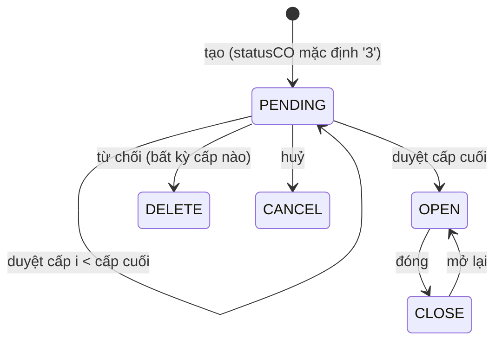

# Yêu cầu tuyển dụng (YCTD / Recruitment Request)

## Trạng thái & chuyển trạng thái

YCTD có **hai trục trạng thái độc lập**:

- `approverTree[i].status` (`ApproveStatusEnum`): `pending` · `approved` · `rejected` — mỗi cấp duyệt một node.
- `statusCO` (`StatusCOEnum`): `'3'` PENDING (chờ duyệt) · `'0'` OPEN · `'1'` CLOSE · `'4'` CANCEL · `'2'` DELETE (bị từ chối).

| Hành động | API (FE gọi) | Điều kiện | Kết quả |
| --- | --- | --- | --- |
| Tạo | `POST /api/recruitment-requests/config` (body qua JSONata `TRANSFORM_RECRUITMENT_REQUEST`; shinhanbank = `$`, giữ nguyên) | — | `statusCO='3'`, `level='1'` nếu không gửi, `code` sinh tự động |
| Duyệt | `PATCH /:id/approve` | Có node `pending`; user nằm trong `approvers` của **node pending đầu tiên** | Node → `approved` + `approvedBy/approvedDate`; nếu là node cuối → `statusCO='0'` OPEN |
| Từ chối | `PATCH /:id/reject` body `{ note }` | Như duyệt | Node → `rejected`, `note` = lý do; `statusCO='2'` |
| Huỷ | `PATCH /:id/change-status` `{ status:'4', reason? }` | `statusCO` hiện tại = `'3'`; user là `createdBy` **hoặc** `requestedBy` **hoặc** thuộc nhóm tag `SYS_ADM`/`SYS_ADM_ROOT` | `statusCO='4'` |
| Đóng | `change-status` `{ status:'1', reason? }` | `statusCO` hiện tại = `'0'` | `statusCO='1'`; **đóng luôn các kế hoạch tuyển dụng còn mở gắn với YCTD** (gỡ tin đăng ngoài) |
| Mở lại | `change-status` `{ status:'0' }` | `statusCO` hiện tại = `'1'` | `statusCO='0'` (không mở lại kế hoạch) |

- Chuyển trạng thái sai → `400 Invalid status transition`. Huỷ không đủ quyền → `403`.
- Không có đường nào từ `DELETE` (bị từ chối) hay `CANCEL` sang trạng thái khác qua `change-status`.
- **Đã huỷ thì không được duyệt / từ chối nữa** (user chốt 2026-10-10). UI tab chờ duyệt lọc `statusCO = '3'` nên YCTD đã huỷ biến khỏi danh sách duyệt; nhưng backend `handleApprovalTree` **không kiểm tra `statusCO`** → xem _Nghi bug_.
- Duyệt theo **thứ tự**: chỉ node `pending` đầu tiên được xử lý; người không thuộc node đó → `400 User is not in the approver list`. Không còn node pending → `400 No pending approval found`.

**Nhãn trên UI danh sách (tiếng Anh)**: cột duyệt hiện tên người duyệt khi đang chờ / `Approved`; cột trạng thái `Waiting` (PENDING), `Open`, `Cancelled`, `Reject` (kèm lý do ở cột "Reason for reject").

## Quyền / vai trò

- Tài khoản QA `dev_shinhanbank` hiển thị là **"Thong Quản trị Hệ thống" — System Admin** → được huỷ mọi YCTD.
- Ai **thấy** YCTD (`CheckPublicInterceptor`): `createdBy`, `requestedBy`, có trong `assignTo`, có trong `approverTree.approvers`, hoặc khớp `tags` (tag `userName:<x>` của SYS_ADM cùng phòng ban — tự sinh khi tạo/đọc).
- Đóng / mở lại: backend **không** kiểm tra thêm người làm (chỉ quyền action `ManageOne`).
- Sửa YCTD (`PATCH /:id/config`): các node đã duyệt (trước node pending) **không được đổi** → `FORBID_CHANGE_REQUEST_APPROVED_NODE`.
- Backend không cấm người duyệt trùng người tạo.

## Quy tắc dữ liệu

- **Bắt buộc (schema)**: `code`, `name`, `level`.
- **Mã YCTD shinhanbank** = `<Area><Type><YY><NNN>`:
  - Area: `extra.area` ∈ N/NORTH → `N`, S/SOUTH → `S`; khác → lỗi `Area must be N or S`.
  - Type: `content.reason` ∈ `1`/I/INCREASE → `I` (tăng mới), `2`/R/REPLACE → `R` (thay thế); khác → lỗi.
  - YY: năm của `content.fromDate`, không có thì `requestedDate` (múi giờ +07:00).
  - NNN: bộ đếm 3 chữ số, **đếm chung theo (tenant, năm, Type)** — N và S dùng chung dãy; vượt 999 → lỗi.
  - Ví dụ: `NI26074` = miền Bắc, tăng mới, 2026, số 74. Tenant không có cấu hình → `YCTD-xxxxxxxx`.
  - Spec backend `recruitment-request-code.spec.ts` kỳ vọng `N-R-26-001` là **lỗi thời** so với YAML.
- **Form tạo (UI)** — wizard 3 bước, mỗi bước là một dynamic form (`data/mongo/data/stg/shinhanbank/dynamic-forms.yaml`, bản EN id `…086/088/087`); nút `Cancel` / `Continue`. `*` = bắt buộc.

  | Bước | Trường (`name` → payload) |
  | --- | --- |
  | 1 _Basic Information_ (`recruitment-request-form-0`) | `sample` (mẫu YCTD, tuỳ chọn — chọn mẫu sẽ **copy cả approverTree** của mẫu) · `name`* · `requisitionType` (mặc định `external`) · `area`* (`north`/`south` → `extra.area`) · `managerName`* Line Manager (→ `extra.managerName`) · `level1`* Head Office/Business Unit · `level2..5` (readonly khi không có lựa chọn) · `assignTo`* TA Admin · `requestedDate`* (mặc định hôm nay) |
  | 2 _Job Information_ (`recruitment-request-form-1`) | `workPlace`* · `jobTitle`* · `jobGrade`* · `employmentType`* · `reason`* Hình thức tuyển dụng (`increase`/`replace` → `content.reason`) · nếu increase: `increaseType`* · nếu replace: `employeeName`*, `been`, `expectedRotationDate`*, `fromTo`*, `replacementType`* · `boundary_date`* (mặc định hôm nay, gọi integration lấy định biên) · `approvedHeadcount`, `currentActualHeadcount`, `availableHeadcount` (phải là số dương) · `quantity`* (mặc định 1) · `note` · `jobDescriptionRef` · `jobDescriptionFile` |
  | 3 _Advanced Settings_ (`recruitment-request-form-2`) | `approvers`* Approver — **chọn tay**, từ mọi user active (tìm theo text) → `approverTree[].approvers` · `position`, `email` (readonly) · `attachment` · `requisitionType`* · `note` · `approveFile` |

- `requestedBy` = **người đang đăng nhập** (`GET /api/users/me`), không phải Line Manager.
- `statusCO` lúc tạo: `'3'` (chờ duyệt); chỉ khi `approvedType = 'offline'` mới tạo thẳng `'0'` OPEN. Form bước 3 luôn ghi `extra.approvedType = 'online'`.
- **Mã sinh từ form**: Miền = `area` (bước 1); Loại = `reason` (bước 2); Năm = `requestedDate` (bước 1) vì `content.fromDate` lấy từ `approvedDate` mà form shinhanbank **không có** trường này. → Chọn `North` + `Increase` ⇒ mã `NI<YY><NNN>`.
- **TA Admin (`assignTo`)**: bắt buộc, chọn nhiều, lựa chọn = mọi user active (tìm theo text). Mặc định điền sẵn toàn bộ user thuộc nhóm tag `RECRUITMENT_ADM`/`RECRUITER` (hiện: Bich Ngoc, CBTD Cán bộ tuyển dụng, Hanh Dung, QLTD Quản lý tuyển dụng — **người thật**). Không để trống được, nhưng **được xoá hết rồi chọn riêng tài khoản QA** (tìm `dev_shinhanbank`).
- Line Manager và Approver cũng chọn từ mọi user active → chọn tài khoản QA được.
- Nhãn có thể chưa dịch dù UI tiếng Anh (vd "Khu vực", "Hình thức tuyển dụng", cột "Đơn vị") → selector theo `name`/vị trí hoặc nhãn tiếng Việt.

## Màn hình & thao tác (UI staging, kiểm chứng 2026-10-10)

- **Định biên chặn bước 2**: "Remaining Vacancies" (`availableHeadcount`) phải > 0. Lấy từ `POST /api/integration-templates/boundary` theo năm, lọc theo **đủ** mã đơn vị level1–5 (`t<tháng> − aM<tháng>`); chọn thiếu cấp → "Not configured" → lỗi "Phải là số dương". Đơn vị có định biên trên staging (10/2026): **ONCE › Cụm Once › Khối Once › Phòng Once, Team để trống** (25 − 7 = 18). Giá trị tính bất đồng bộ — phải chờ có số rồi mới `Continue`.
- Bước 2 nhãn tiếng Anh: Workplace (`Office 127`), Job title (`Product Technical`, danh sách tải chậm), Maximum Job Grade (`J1`), Recruitment Type (`FTE`/`Outsource`), Recruitment Method (`Replace`/`Increase`), "Loại Increase" (`Project`/`Backup`/`New headcount`), Headcount Planning Month, Approved Headcount, Hired, Remaining Vacancies, Number of recruitment.
- Bước 3 "Approval Levels": mỗi cấp có Approver (+ Position, Email readonly), nút **Add approval level** (nhiều cấp được), nút lưu là **Save** → `POST /api/recruitment-requests/config`, trả về YCTD có `_id`, `code`. Sau khi lưu URL vẫn ở `/create`.
- Ô user (Line Manager, TA Admin, Approver) tìm phía server bằng `$text` — gõ `dev_shinhanbank` ra "dev_shinhanbank - Thong Quản trị Hệ thống".
- **Màn duyệt** `/recruitment-requests/:id/process-approval`: nút `Approve request` (modal: Recruitment Request Type mặc định External, Notes, File evidence → **Agree**), `Reject request` (modal "Enter reason" → Agree), `Cancel request`.
- **Màn chi tiết** `/recruitment-requests/:id`: `Cancel request` khi chờ duyệt; `Close request` khi Open (modal cảnh báo đóng cả kế hoạch, "Enter reason" → Agree); `Open request` khi Closed (mở lại).
- YCTD **đã huỷ: màn duyệt không còn nút Approve request** (UI tuân quy tắc).
- DOM dynamic form không có `name`: mỗi trường là khối `div[ehiringnoderefvar="element"]` lá, nhãn ở `ehiring-section span span`.

## Tác dụng phụ

| Khi | Ai nhận | Kênh |
| --- | --- | --- |
| Tạo | Người duyệt của node pending đầu tiên | Email + in-app (`RECRUITMENT_REQUEST_CREATED`) |
| Duyệt cấp giữa | Người duyệt node pending kế tiếp | Email + in-app (pending approval, theo step) |
| Duyệt cấp cuối / từ chối | `requestedBy` (người tạo/HM) | Approval completed |
| Duyệt cấp cuối | Tất cả `assignTo` | Approved notify |
| Đóng | **Chỉ `requestedBy`** (người tạo), không cc. Comment code ghi "recipient assignTo, cc requestedBy" nhưng code gửi cho requestedBy. Cần mail template `RecruitmentRequestClosed` `private: true` của tenant — seed shinhanbank **không có** → có thể không gửi (lỗi bị nuốt, đóng vẫn thành công). + `RECRUITMENT_PLAN_FINISHED` cho từng kế hoạch bị đóng | Email |
| Tạo/sửa có `body.approvedType = 'online'` + có integration template `recruitment-request` | Chạy integration (hệ thống ngoài) | Integration — seed shinhanbank **không có** template này |
| Bước 2, chọn `boundary_date` | Gọi integration lấy định biên (đọc) | Integration |

→ Để không làm phiền người thật: Approver, Line Manager, TA Admin đều chọn tài khoản QA (requestedBy tự là QA); không dùng YCTD mẫu (`sample`) vì copy approverTree của mẫu; YCTD test không gắn kế hoạch thật.

## Điểm chưa chắc

- [x] `NI26072` Approved + Cancelled → user chốt: **đã huỷ thì không được duyệt** → chuyển sang _Nghi bug_.
- [x] Người duyệt → **chọn tay ở bước 3** (user chốt); chọn được tài khoản QA (options = mọi user active).
- [x] TA Admin → bắt buộc, không để trống; xoá hết mặc định rồi chọn riêng QA (đọc form config).
- [x] Mã → `area` (bước 1), `reason` (bước 2), năm của `requestedDate` (đọc form config + JSONata).
- [x] Email đóng → chỉ `requestedBy`; có thể không gửi vì thiếu template (đọc `email-recruitment-request.ts`).
- [x] Từ chối → UI **bắt buộc lý do** (cả 5 màn: list-approval, application-entry, edit-entry, plan-entry, process-approval chặn chuỗi rỗng); backend nhận `note` rỗng.
- [x] Định biên → có dữ liệu; không có định biên thì **chặn** `Continue` (xem _Màn hình & thao tác_).
- [x] Nhiều cấp duyệt → có (nút Add approval level). Flow M1 dùng 1 cấp; luồng duyệt nhiều cấp chưa kiểm thử.

## Nghi bug

- 2026-10-10 · (chưa có spec) · Backend `PATCH /recruitment-requests/:id/approve|reject` không kiểm tra `statusCO`; YCTD đã huỷ (`'4'`) mà còn node `pending` vẫn duyệt/từ chối được. Bằng chứng: `NI26072` trên staging hiện Approved + Cancelled (đã xoá mềm khi dọn dữ liệu 2026-10-10 theo yêu cầu user — vẫn còn trong DB với cờ xoá). Quy tắc user chốt: đã huỷ thì không được duyệt. · UI đã chặn (màn duyệt ẩn nút Approve — spec `đã huỷ thì không được duyệt` xanh), nên lỗ hổng chỉ còn ở **API**: gọi thẳng `PATCH /approve` vẫn qua. Chưa tái hiện bằng API vì không ghi tắt qua API (CLAUDE.md); cần user quyết có muốn thêm kiểm thử API này không.
